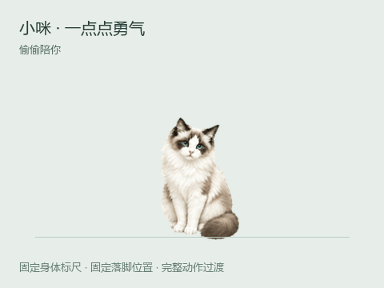

# 咪咪 · 偷偷陪你

一只胆小、长毛、脚底很快的猫。她会小声地等你，做完事才敢「咪」一下。安静趴下来时是一大堆毛，身体并不会因为动作换帧而缩放。

当前桌面版包含 130 帧动作与视线姿态。左右奔跑各 16 帧，跳跃 10 帧，坐卧过渡 12 帧；待机、轻踩前爪、招手与毛团休息也已补帧。原有固定格式的兼容素材一并保留。详见 [角色与动画](docs/artwork.md)。



[下载 Windows 桌宠](https://github.com/fuchenwuhky/mimi-desktop-pet/releases/latest) · [智能体接入](docs/integrations.md) · [素材与制作过程](docs/materials.md)

## 打开猫猫

在 [Releases](https://github.com/fuchenwuhky/mimi-desktop-pet/releases/latest) 下载 `Mimi-Pet-1.1.0-Windows.exe`，双击即用，不需要安装 Node.js。支持 Windows 10 / 11 x64。需要长期使用智能体 hooks 时，推荐下载 ZIP 版，解压到固定位置并保留整个文件夹，适配器路径就能稳定保留。源码自行打包的成品在 `dist/`。

从源码运行：

```powershell
npm install
npm start
```

首次运行在 `%USERPROFILE%\.mimi-pet` 保存设置和智能体接入令牌。应用只监听本机，不向云端发送照片、台词或工作内容。默认没有声音。

## 和她相处

- 轻点：轻轻摸摸。双击：鼓起勇气咪一声。
- 拖动猫猫：换个窝。右键猫猫或托盘图标：打开菜单。
- 「撒腿就跑」：在当前屏幕安全范围内跑一小段。
- 「猫猫大小」：选择一个固定比例，所有动作都保持这个比例。
- 「自己找点事做」：开关闲置时的随机动作；「日常动作频率」可选慢悠悠、刚刚好、活泼一点。
- 「安静模式」：减少没事时的台词；「减少动作」：静止显示，保留状态提醒。
- 「鼠标穿透」：让鼠标完全穿过猫猫，从托盘菜单取消。
- 猫猫不见了：点托盘，或选择「带她回到屏幕右下角」。

闲着时，她会按随机间隔偷偷看一眼、轻踩前爪、试着打招呼、趴成毛团，偶尔朝一个方向溜走。同一个动作不会连续重复，跑步和趴卧有额外冷却。你正在拖动、窗口隐藏、智能体等你回应时，自发动作会暂停；恢复后重新等待，不补播积压的动作。安静模式保留小动作但不主动说话。

## 各种智能体都能陪

接入方式与当前覆盖范围见 [智能体接入说明](docs/integrations.md)。无论是什么智能体，都可以用相同的本机事件接口报告状态：

```powershell
node scripts/event.cjs working Codex
node scripts/event.cjs waiting Claude "那个……好像轮到你啦。"
node scripts/event.cjs success OpenCode
```

事件为 `working / waiting / success / error / idle`。多人同时工作时，依次优先显示等待你、出错、工作中、完成。每个来源和会话独立追踪；工作状态 10 分钟未续报自动恢复，避免一整晚傻等。长任务每 30 秒续报一次 `working`；只支持事件 hooks 的智能体表示最近活动，超过十分钟的单次操作需要额外心跳才能一直保留状态。

## 查看与打包

```powershell
npm run preview  # 打开 http://127.0.0.1:47832/src/index.html
npm test         # 接口安全、会话恢复与固定画格测试
npm run dist     # 生成 Windows 便携版
```

透明桌宠采用 Electron。动画素材见 `assets/pet/manifest.json`，每一帧从固定画格读取，禁止按当帧内容包围盒缩放或重新居中。运行时只有用户主动选择的全局缩放；奔跑用移动整个窗口表现，保持猫的比例。

## 接口约定

`POST http://127.0.0.1:47831/events`，`Content-Type: application/json`，请求头 `X-Mimi-Token` 为 `%USERPROFILE%\.mimi-pet\token` 文件内容。载荷：

```json
{"source":"Codex","event":"working","message":"我帮你盯着……","sessionId":"my-task"}
```

`message` 和 `sessionId` 可省略。`source` 为 1–48 位字母、数字、空格或 `._-`，`message` 最长 160 字，请求体最大 4 KB。本机服务拒绝浏览器跨域请求；令牌不能放进网站前端或分享出去。

跨平台源码可运行于支持 Electron 的 macOS/Linux 桌面；此交付只实际打包验证 Windows x64。各智能体是否原生支持 hooks 取决于其版本，未提供原生 hooks 的工具通过通用命令包装器接入。桌宠本身不需要 Node.js；使用命令行适配器需要 Node.js 18 或更新版本。解压后执行 `node adapters/generate-configs.cjs`，会按新位置生成接入片段，再参照接入说明合并到需要的工具。不会自动修改已有智能体设置。

## 素材、来源与许可

仓库保留了全部 13 张[猫咪原照](art/reference/photos/)、[参考拼图](art/reference/photos-contact.jpg)、生成源图、提示词、修订版本、逐帧素材、图集、GIF / MP4 预览和检查记录。原照与拼图经项目发起人明确同意公开。目录导航见 [素材清单](docs/materials.md)，复现处理流程见 [创作工具说明](docs/recreating-artwork.md)。运行桌宠只需要 `assets/pet/`，不需要安装图像生成工具。

角色图及动画由内置 imagegen 生成和整理，没有使用鲸鱼娘项目的角色图或动画素材。代码采用 [MIT](LICENSE)；照片与美术资产的范围说明见 [ASSETS-LICENSE.md](ASSETS-LICENSE.md)。
